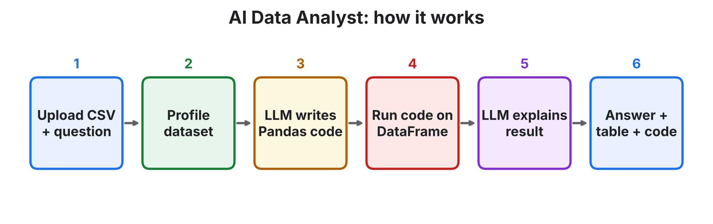

<div align="center">

# 📊 AI Data Analyst

**Upload a CSV. Ask questions in plain English. Get answers, tables, and the code behind them.**


</div>

---

## ✨ What it does

No SQL, no spreadsheets formulas, no code. Drop in a CSV and just ask:

> *"Which item type made the highest total profit?"*
> *"Is there a correlation between prompt engineering skill and post-semester GPA?"*
> *"Now show me the same thing for each region."*

The app answers in a friendly sentence, shows the **raw result table**, and reveals the **exact Pandas code** it ran, so you can always verify the answer.

## 🚀 Features

- 💬 **Natural-language questions** about any CSV file
- 🧠 **LLM-generated Pandas code**, executed to get real numbers instead of guesses
- 🔍 **Transparent answers**: friendly sentence + raw table + the code that produced it
- 🔁 **Follow-up questions** ("now do the same for...") thanks to per-session conversation history
- 🔄 **Smart reset**: uploading a different CSV automatically starts a fresh conversation
- 🧾 **Dataset profiling**: column types and categorical values are sent to the model so it writes more accurate code
- 🤖 **Model-agnostic**: swap the model with one environment variable via OpenRouter

## 🧩 How it works

<p align="center">
  
</p>

1. **Profile**: Pandas reads the CSV and builds a summary of column types and low-cardinality categorical values.
2. **Generate**: that profile, the recent conversation, and your question go to the LLM, which returns a short Pandas snippet that stores its output in `result`.
3. **Execute**: the snippet runs against your DataFrame.
4. **Explain**: the raw result is sent back to the LLM to be phrased as one friendly sentence.
5. **Respond**: the UI shows the sentence, the result table, and the code.

## 🛠️ Tech stack

| Layer | Tools |
|---|---|
| Backend | Python, Flask, Pandas |
| LLM access | [OpenRouter](https://openrouter.ai) (default model: `openai/gpt-4o-mini`) |
| Frontend | Plain HTML, CSS and JavaScript (`frontend/index.html`) |
| Deployment | Gunicorn on Render for the API, Vercel for the frontend |

## 📁 Project structure

```
ai-data-analyst/
├── app.py                          # Flask app: routes, prompts, history, code execution
├── frontend/
│   ├── index.html                  # Single-page chat UI
│   └── vercel.json                 # Proxies API routes to the hosted backend
├── sales.csv                       # Sample dataset: global sales orders
├── ai_student_impact_dataset_.csv  # Sample dataset: GenAI use vs. student outcomes
├── requirements.txt
└── README.md
```

## ⚡ Quick start

**1. Clone and install**

```bash
git clone https://github.com/Raushan23raj/Ai-Data-Analyst.git
cd Ai-Data-Analyst

python -m venv .venv
source .venv/bin/activate        # Windows: .venv\Scripts\activate
pip install -r requirements.txt
```

**2. Add your API key**

Get a key from [OpenRouter](https://openrouter.ai/keys), then create a `.env` file in the **folder that contains the project folder** (one level above `app.py`):

```env
OPENROUTER_API_KEY=your_key_here

# Optional
OPENROUTER_MODEL=openai/gpt-4o-mini
FLASK_SECRET_KEY=any_long_random_string
```

**3. Run it**

```bash
python app.py
```

Open **http://localhost:5000**, upload one of the sample CSVs, and start asking.

## ⚙️ Configuration

| Variable | Required | Default | Purpose |
|---|---|---|---|
| `OPENROUTER_API_KEY` | ✅ | none | Authenticates requests to OpenRouter |
| `OPENROUTER_MODEL` | ❌ | `openai/gpt-4o-mini` | Any model available on OpenRouter |
| `FLASK_SECRET_KEY` | ❌ | random on each start | Keeps browser sessions valid across restarts |

Conversation limits live at the top of `app.py`: 50 turns stored per session, the last 5 sent to the model as context, and up to 200 concurrent sessions kept in memory.

## 🔌 API endpoints

| Method | Route | Description |
|---|---|---|
| `GET` | `/` | Serves the chat UI |
| `POST` | `/analyze` | Takes `file` (CSV) and `question`; returns `answer`, `code`, `raw_result` |
| `GET` | `/history` | Restores the current session's conversation |
| `POST` | `/clear` | Starts a fresh conversation |

## 🧪 Try these questions

**With `sales.csv`**
- What is the total profit by region?
- Which item type has the highest average unit price?
- How do online and offline sales compare in revenue?

**With `ai_student_impact_dataset_.csv`**
- What is the average post-semester GPA for each burnout risk level?
- Does weekly GenAI usage correlate with GPA change?
- Which major category has the highest perceived AI dependency?

## ⚠️ Known limitations

- **Code execution:** the app runs LLM-generated Python with `exec`. This is fine for a local demo or portfolio project, but it is not sandboxed, so don't expose it publicly with sensitive data. A production version should run generated code in an isolated environment.
- **In-memory sessions:** history is stored in server memory, so it resets when the server restarts.
- **Accuracy:** generated code can occasionally be wrong. That's why the code and raw table are always shown next to the answer.

## 🗺️ Ideas for next steps

- [ ] Sandbox code execution
- [ ] Auto-generated charts for numeric results
- [ ] Support for Excel files
- [ ] Persistent chat history (database)

## 👤 Author

**Raushan Raj**, B.Tech CSE at BIT Mesra
GitHub: [@Raushan23raj](https://github.com/Raushan23raj)

---

<div align="center">⭐ If you found this useful, consider starring the repo!</div>
